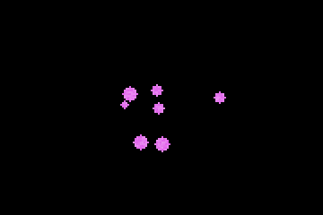
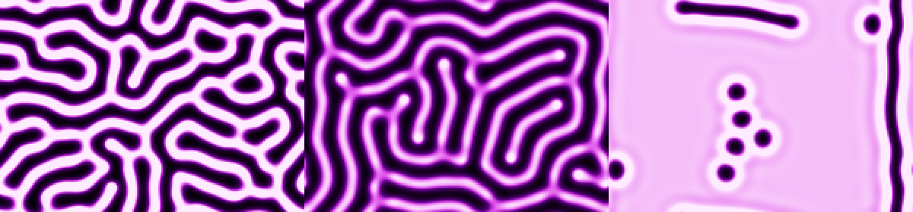
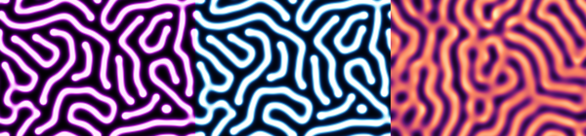

# reaction-diffusion

La réaction-diffusion de **Gray-Scott**, simulée et affichée **en direct dans le terminal**, en C, sans aucune bibliothèque. On clique pour déposer de la matière, et des coraux, des cellules qui se divisent ou des labyrinthes poussent sous le curseur.



*Motif « mitose » : chaque tache grossit puis se coupe en deux.*




## Lancer

```sh
make
./rd               # motif « corail »
./rd mitose
./rd carte         # la carte des paramètres
```

| Touche | Effet |
|---|---|
| `1` à `9` | corail, mitose, labyrinthe, solitons, vers, trous, pulsations, chaos, u-skate |
| clic gauche (et glisser) | déposer du produit V |
| clic droit | effacer |
| `espace` | pause |
| `r` | recommencer |
| `c` | changer de palette (violet, magma, glace, mousse) |
| `+` `-` | plus ou moins de pas de calcul par image |
| `m` | carte des paramètres |
| `q` | quitter |

Il faut un terminal qui gère les couleurs 24 bits et la souris (Konsole, GNOME Terminal, kitty, Alacritty, WezTerm, Windows Terminal...).

Sans terminal, on peut aussi calculer une image :

```sh
./rd vers --export vers.png --etapes 12000 --taille 300x200 --palette glace
```

## Ce qui se passe

Deux produits chimiques, U et V, sont répartis sur une grille. En chaque point :

```
dU/dt = Du·ΔU − U·V² + F·(1 − U)
dV/dt = Dv·ΔV + U·V² − (F + k)·V
```

- **diffusion** (`Du·ΔU`, `Dv·ΔV`) : chaque produit s'étale vers les cases voisines, U deux fois plus vite que V ;
- **réaction** (`U·V²`) : là où il y a du V, il transforme U en V (`U + 2V → 3V`), il s'auto-alimente ;
- **alimentation** (`F·(1 − U)`) : on remet du U partout, au taux F ;
- **disparition** (`(F + k)·V`) : le V s'élimine au taux F + k.

Rien que deux nombres, F et k, décident de tout le paysage. C'est le mécanisme qu'Alan Turing proposait en 1952 pour expliquer les taches et les rayures des animaux.


*Mode carte (touche `m`) : k varie de 0,03 à 0,07 de gauche à droite, F de 0 à 0,08 de bas en haut. Chaque région de l'image a ses propres paramètres, ce qui montre d'un coup tous les régimes (comme la carte de John Pearson, 1993).*

## Détails de mise en œuvre

**Le laplacien** `ΔU` est approché par un noyau 3×3 : 0,2 pour les 4 voisins directs, 0,05 pour les 4 diagonales, −1 au centre. La grille est un tore : ce qui sort à droite rentre à gauche. Un pas d'Euler explicite, un tampon pour l'état suivant, et on échange les pointeurs.

**Deux pixels par caractère.** Le caractère `▀` (demi-bloc haut) est dessiné avec une couleur de texte (la moitié haute) et une couleur de fond (la moitié basse), en `ESC[38;2;r;g;bm` / `ESC[48;2;r;g;bm`. Une ligne de terminal affiche donc deux lignes de la grille. Les codes de couleur ne sont réémis que lorsqu'ils changent, et toute l'image part en un seul `fwrite`.

**La souris.** `ESC[?1002h` demande au terminal de signaler les clics et les glissements, `ESC[?1006h` en format SGR : `ESC[<bouton;x;yM`. Le terminal est passé en mode brut (`termios`, sans écho ni attente de la touche Entrée), sur l'écran alternatif, et tout est restauré à la sortie, même après Ctrl-C. `SIGWINCH` signale un redimensionnement de la fenêtre.

**Les nombres sous-normaux.** Loin des motifs, V tend vers 0 sans jamais l'atteindre, et finit dans les flottants « sous-normaux » (plus petits que 10⁻³⁸), que le processeur traite plus de 20 fois plus lentement. Le motif « vers » passait de 1,6 s à 40 s de calcul. Ramener à 0 tout ce qui passe sous 10⁻²⁰ règle le problème.
