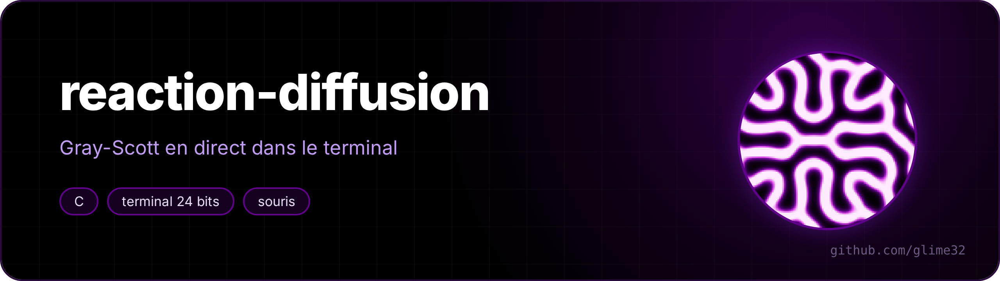

<p align="center"></p>

<p align="center"> </p>

**Gray-Scott** reaction-diffusion, simulated and shown **live in the terminal**, in C, without any library. Click to drop some chemical, and corals, dividing cells or mazes grow under the cursor.

<p align="center"><a href="README.fr.md">🇫🇷 Version française</a></p>


*The "mitose" (mitosis) pattern: each spot grows, then splits in two.*


## Run

```sh
make
./rd               # "corail" (coral) pattern
./rd mitose
./rd carte         # the parameter map
./tests.sh         # simulates without a terminal and checks the images
```

| Key | Effect |
|---|---|
| `1` to `9` | coral, mitosis, maze, solitons, worms, holes, pulsating, chaos, u-skate |
| left click (and drag) | drop some V |
| right click | erase |
| `space` | pause |
| `r` | restart |
| `c` | change palette (violet, magma, ice, moss) |
| `+` `-` | more or fewer computation steps per frame |
| `m` | parameter map |
| `q` | quit |

You need a terminal with 24-bit colour and mouse support (Konsole, GNOME Terminal, kitty, Alacritty, WezTerm, Windows Terminal...).

Without a terminal, it can also compute a picture (`--etapes` = steps, `--taille` = size, palette names are French):

```sh
./rd vers --export vers.png --etapes 12000 --taille 300x200 --palette glace
```

With a `.ppm` name, the picture comes out as PPM (easier to read back from a script).

## What happens

Two chemicals, U and V, are spread over a grid. At each point:

```
dU/dt = Du·ΔU − U·V² + F·(1 − U)
dV/dt = Dv·ΔV + U·V² − (F + k)·V
```

- **diffusion** (`Du·ΔU`, `Dv·ΔV`): each chemical spreads to the neighbouring cells, U twice as fast as V;
- **reaction** (`U·V²`): where there is some V, it turns U into V (`U + 2V → 3V`), it feeds itself;
- **feed** (`F·(1 − U)`): U is added back everywhere, at rate F;
- **kill** (`(F + k)·V`): V is removed at rate F + k.

Just two numbers, F and k, decide the whole landscape. It's the mechanism Alan Turing proposed in 1952 to explain animal spots and stripes.


*Map mode (`m` key): k goes from 0.03 to 0.07 from left to right, F from 0 to 0.08 from bottom to top. Each region of the picture has its own parameters, which shows every regime at once (like John Pearson's map, 1993).*

## Implementation details

**The Laplacian** `ΔU` is approximated by a 3×3 kernel: 0.2 for the 4 direct neighbours, 0.05 for the 4 diagonals, −1 in the middle. The grid is a torus: what leaves on the right comes back on the left. One explicit Euler step, a buffer for the next state, and the pointers are swapped.

**Two pixels per character.** The `▀` character (upper half block) is drawn with a text colour (the top half) and a background colour (the bottom half), using `ESC[38;2;r;g;bm` / `ESC[48;2;r;g;bm`. So one terminal line shows two rows of the grid. Colour codes are only sent again when they change, and the whole frame goes out in a single `fwrite`.

**The mouse.** `ESC[?1002h` asks the terminal to report clicks and drags, `ESC[?1006h` in SGR format: `ESC[<button;x;yM`. The terminal is put in raw mode (`termios`, no echo, no waiting for Enter), on the alternate screen, and everything is restored on exit, even after Ctrl-C. `SIGWINCH` reports a window resize.

**Subnormal numbers.** Far from the patterns, V tends to 0 without ever reaching it, and ends up in "subnormal" floats (smaller than 10⁻³⁸), which the CPU handles more than 20 times slower. With parameters where the pattern dies out, a run went from 1.6 s to 40 s. Setting everything below 10⁻²⁰ to 0 fixes it.
